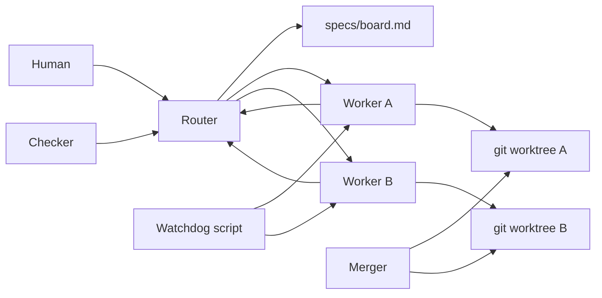
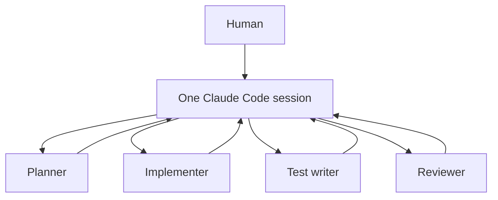

# Super agent vs subagents

A small public lab. Two ways to have [Claude Code](https://code.claude.com/docs/en/cli-reference) build the same Recipe Box tickets, so you can see the difference yourself.

**Subagents** are a head chef. One person owns the order, and they can send someone for onions or pastry. They still plate the dish. Everyone shares one counter: one Claude Code session, one working tree, and a context that holds every ticket.

**Super agent** is the expediter. They never cook. They read the tickets on the rail, hand each ticket to a cook at a separate station, and check the plate against the ticket before it leaves. A cook who burns a dish gets that same dish back. The expediter calls you over only for a real choice, not to ask how to turn the oven on.

The super-agent shape comes from DeepSeek's research prototype, [deepseek-ai/dsh-superagent-prototype](https://github.com/deepseek-ai/dsh-superagent-prototype). This repository is not that prototype and does not contain its code. It is a learner harness that uses Claude Code as the cook in both kitchens. DeepSeek's writeup also describes a watchdog that watches the cooks. The public prototype left that piece as later work. The watchdog here is a small script so you can see the idea.

Nothing in this README is a measured comparison. The results table starts empty.

## Architecture

Setup A, the super agent. The router never edits code. Workers do not talk to you. The watchdog script does not call a model.



Setup B, subagents. One session owns every ticket. Delegation stays inside that session.



## Prerequisites

- Node.js 20 or newer. This repo was checked on Node 22.
- git
- For a real comparison, the Claude Code CLI (`claude --version`), and either a login (`claude auth login`, then `claude auth status`) or `ANTHROPIC_API_KEY` in the environment. Do not commit the key.
- A throwaway clone. The runners pre-approve `Bash` so an unattended session can run `npm test`. That is enough power to damage a checkout you care about.
- Claude Code is the default agent CLI. A Codex (ChatGPT) subscription can run the same two setups. See [Running with Codex](#running-with-codex).

`npm test` and `--dry-run` do not need an API key.

## Quick start

```bash
npm install
npm test
npm run typecheck
npm run superagent -- --dry-run
npm run subagents -- --dry-run
```

The API, create and list:

```bash
npm start
```

```bash
curl -s -X POST http://127.0.0.1:3000/recipes \
  -H 'content-type: application/json' \
  -d '{"title":"Tomato Soup","ingredients":["tomatoes"],"steps":["Simmer"]}'
curl -s http://127.0.0.1:3000/recipes
```

The sample stores recipes in memory. Restarting the process clears them. There is no auth.

## Map

| Path | What it is |
| --- | --- |
| `src/` | Recipe Box. Create and list, plus a `q` query the baseline tests do not cover. |
| `docs/prd.md` | v1: search, favorites, tags, pagination, validation. No auth. |
| `.claude/skills/write-tickets/SKILL.md` | Interview, then write tickets. Invoke with `/write-tickets`. |
| `specs/board.md` | draft / ready / done, solo / team, runs alongside, waits for. |
| `specs/tickets/` | Five ready tickets. Each has `spec.md` and `eval.md`. |
| `superagent/` | What the expediter setup is. |
| `.claude/agents/` | Router, worker, watchdog, merger, checker, and the team subagents. |
| `.codex/agents/` | Codex team subagents: planner, implementer, test-writer, reviewer. Used only with `--agent-cli codex`. |
| `scripts/run-superagent.ts` | Worktrees, parallel workers, logs, timings. Claude Code by default. Codex with `--agent-cli codex`. |
| `scripts/watchdog.ts` | Flags silent, stuck, or looping workers. |
| `subagents/` | Plain session and team session. |
| `scripts/run-subagents.ts` | One headless session, then a delegation count. |
| `scripts/metrics.ts` | Reads a real `timings.json`. Does not invent numbers. |
| `results/` | Empty table and a run-log template. |

## Tickets

The board is the queue both setups share.

- `ready` is dispatched. `draft` is still being written. `done` is finished.
- `solo` means one worker does the ticket. `team` means that worker may split it across subagents. The five examples are solo so both labs start from the same work. Change the cell if you want the other mode.
- `runs alongside` is a hint. `waits for` is a rule. Pagination waits for search because both edit the list route.

`/write-tickets` turns a PRD into more of these folders. It asks questions until the spec, the file boundaries, and the test command are clear. New tickets stay `draft` until you mark them `ready`.

## Claude Code flags the runners actually pass

Checked against the [CLI reference](https://code.claude.com/docs/en/cli-reference) and the [headless page](https://code.claude.com/docs/en/headless). The runners do not invent a `--headless` flag. `-p` is the headless mode.

| Flag | Why |
| --- | --- |
| `-p` | Run one prompt and exit. |
| `--output-format stream-json` and `--verbose` | JSON lines, including a final result event the metrics script can read. |
| `--permission-mode acceptEdits` | File edits do not prompt. Override with `--permission-mode` or `SUPERAGENT_PERMISSION_MODE`. |
| `--allowedTools Read,Edit,Write,Bash` | Pre-approve those tools so the process is not stuck on a prompt. `Bash` is broad on purpose. |
| `--max-turns 30` | Cap the loop. |
| `--agent worker` | Setup A only. Selects `.claude/agents/worker.md` for that process. |
| `--name` | A label you can resume. |
| `--add-dir <runs/...>` | The report and heartbeat live in `runs/`, outside the worker's git worktree. `--add-dir` grants access to that directory. The runner creates it before launch. |
| `--resume <session_id>` | One retry of a failed worker in the same session, only if the result event included `session_id`. |

Optional, off unless you set them: `--max-budget-usd`, `--permission-prompts none` (Claude Code v2.1.259+), `--forward-subagent-text` (v2.1.211+), `--bare`, `--append-system-prompt-file` (setup B2).

The runners do not pass `--bare` by default. Bare mode skips project agents and skills, and it does not use a subscription login. Setup A has to load the worker agent. Pass `--bare` on setup B1 only when you want a session that does not auto-load `.claude/agents/`.

`--worktree` / `-w` is a real Claude Code flag. This lab does not use it. The script runs `git worktree add` so the branch name and the path stay obvious to the watchdog.

## Running with Codex

Claude Code stays the default. Codex is a second backend for the same two npm scripts. Checked on 2026-11-10 against the [noninteractive docs](https://developers.openai.com/codex/noninteractive), the [subagents docs](https://developers.openai.com/codex/subagents), and `codex exec --help` from `@openai/codex` 0.167.0.

Prerequisites:

```bash
codex --version
codex login
```

`codex login` stores a ChatGPT subscription login. `CODEX_API_KEY` also works for the one process that needs it. Do not commit either credential. `--dry-run` does not need a login and does not start Codex.

```bash
npm run superagent -- --agent-cli codex --dry-run
npm run subagents -- --agent-cli codex --dry-run --mode plain
npm run subagents -- --agent-cli codex --dry-run --mode team
```

The same switch is `SUPERAGENT_AGENT_CLI=codex`. A flag on the command wins over the environment variable.

Real runs, in a throwaway clone:

```bash
npm run superagent -- --agent-cli codex
npm run subagents -- --agent-cli codex --mode plain
npm run subagents -- --agent-cli codex --mode team
```

`--timeout-seconds` is the wall-clock kill for each Codex process (default 1800, `0` disables it). It does not apply to Claude Code. `SUPERAGENT_TIMEOUT_SECONDS` sets the same value.

### Flag mapping

| Claude Code flag the runners pass | What Codex gets |
| --- | --- |
| `-p <prompt>` | `codex exec <prompt>`. The prompt is the last argument. |
| `--output-format stream-json` and `--verbose` | `--json` (JSONL on stdout) and `--color never`. |
| `--permission-mode acceptEdits` plus `--allowedTools Read,Edit,Write,Bash` | `--approve-for-me`. That flag selects the workspace-write sandbox and routes approvals through automatic review. The CLI rejects `--approve-for-me` together with `--sandbox`, so the runner does not also pass `--sandbox workspace-write`. `--full-auto` is not a current flag and is not passed. |
| `--permission-mode bypassPermissions` | `--dangerously-bypass-approvals-and-sandbox`. No sandbox. Throwaway clone only. |
| `--max-turns` | Nothing. Codex has no turn cap. The runner kills the process after `--timeout-seconds` of wall clock. |
| `--agent <name>` | Nothing. Setup A inlines `.claude/agents/<name>.md` into the prompt. Setup B team uses the TOML files in `.codex/agents/` and a prompt that tells Codex to spawn those agents by name. |
| `--name` | Nothing. The session id is `thread_id` on the `thread.started` event. |
| `--add-dir <runs/...>` | `--add-dir <runs/...>`. `codex exec --help` calls this an extra writable directory. The noninteractive overview page does not mention it. Parent flags have to come before `resume`; `codex exec resume --add-dir` is rejected. |
| `--resume <session_id>` | `codex exec ... resume <session_id> <prompt>`. The runner does not pass `--ephemeral`, because a resumed thread needs its saved rollout. |
| `--append-system-prompt-file` (setup B2) | The file is inlined into the prompt. Codex has no such flag. |
| `--max-budget-usd`, `--permission-prompts`, `--forward-subagent-text`, `--bare` | Not passed. `--bare` does not exist, so a Codex plain run still sees `.codex/agents/`. |

Other Claude permission modes (`default`, `plan`, `auto`, `dontAsk`, `manual`) are rejected on the Codex backend instead of being translated into a flag the CLI does not have.

### What the metrics record

The scripts still do not invent numbers.

- `thread.started.thread_id` becomes `sessionId`.
- The last `turn.completed.usage` object is stored as `usage`. Numeric fields are copied. Missing fields are left out. Turns are not added together. A retry keeps the last process's usage, not the sum of the failed attempt and the retry.
- `totalCostUsd` stays null. The JSONL usage object has token counts and no dollar cost.
- `delegations` is the number of distinct `item.*` events whose item `type` is `collab_tool_call` and whose `tool` is `spawn_agent`. The same item id is counted once across started, updated, and completed. `send_input`, `wait`, and `close_agent` are not delegations. A Codex session that produced events and no `spawn_agent` item records 0, which means the item was absent, not that someone proved the model never tried to delegate. If the log has no recognized Codex events, the count stays null (`not measured`). The noninteractive sample does not show this item. The CLI schema does (`exec_events.rs`, `collab_tool_call` / `spawn_agent`). A build that omits the item will record 0 after `thread.started`. Say that in the run log if your `codex exec --json` output has no `collab_tool_call` lines.
- `turn.failed` and a top-level `error` event mark the process failed. An `item` whose type is `error` does not, because the schema describes that item as non-fatal. The process exit code is still recorded. A wall-clock kill leaves the exit code null and adds a note. The field name in `timings.json` is still `claudeExitCode` for both backends.

### Differences that change the experiment

- Codex spawns a subagent only when the prompt, `AGENTS.md`, or a skill asks. The team prompt asks it to spawn planner, implementer, test-writer, and reviewer. The plain prompt allows a spawn and does not require one.
- Custom agents cannot set their own sandbox or approval mode. They inherit the parent. `planner` sets `features.shell_tool = false`. The reviewer is told not to edit, and that is an instruction, not a sandbox.
- Claude's `--max-turns` stops a loop. The Codex substitute is a wall-clock kill. A quiet worker that is still making progress can be killed at 1800 seconds. Raise `--timeout-seconds` if that happens.
- Report files for setup A live in `runs/`, outside the git worktree. `--add-dir` is what makes that directory writable from the workspace-write sandbox. The runner creates the directory before launch.
- The checker starts `npm start` and calls the API. If the sandbox refuses the listen, the checker fails closed. Do not switch the whole lab to `--dangerously-bypass-approvals-and-sandbox` to get around that.
- Setup A roles (worker, merger, checker) are separate processes, so they are inlined role files, not `.codex/agents` entries. The four team roles are the TOML files.

Use a throwaway clone. `--approve-for-me` can edit the workspace and approve commands inside that sandbox. `bypassPermissions` removes the sandbox. `runs/` logs are gitignored and can contain a prompt that echoed a secret.

## Walkthrough: setup A

Use a throwaway clone.

```bash
git clone https://github.com/chandrakanthbalaraman/superagent-vs-subagents.git
cd superagent-vs-subagents
npm install
npm test
```

1. See the commands, including the two waves. Pagination is in wave 2 because it waits for search.

   ```bash
   npm run superagent -- --dry-run
   ```

2. Optional, and the interesting order: ask the checker to look at the untouched app before any worker edits it.

   ```bash
   npm run superagent -- --only checker --dry-run
   npm run superagent -- --only checker
   ```

   Read `runs/<stamp>/checker/findings.md`. Score it before you open anything else. The scoring note is at the bottom of this file. If you paste this README into an agent, delete that note first.

Workers are branched from the current commit. Commit any local edits before you dispatch, or the worktrees will not contain them.

3. Dispatch the workers, then the merger, then the checker.

   ```bash
   npm run superagent
   ```

   Wave 1 runs search, favorites, tags, and validation, up to three at a time (`--max-parallel`). Each worker gets `.worktrees/<id>` on branch `ticket/<id>`, a symlink to `node_modules`, and a fresh `claude -p`. Logs go to `runs/<stamp>/<id>/`. If the process exits non-zero and the result event has a session id, the runner sends the failure back with `--resume`. It does not open a new branch. After each worker, the runner itself runs `npm test` in the worktree and records the exit code.

   The watchdog script scans every 30 seconds and writes `runs/<stamp>/watchdog-report.json`. A running worker is **silent** when its heartbeat is missing or older than 5 minutes, **stuck** when it is also silent and the worktree's latest commit is older than 5 minutes, and **looping** when the same log line appears at least 8 times in the last 80 lines. Finished workers are ignored. To read a report with the model: `claude --agent watchdog`.

4. The merger runs in `.worktrees/integrate-<stamp>` and is asked to merge the ticket branches and run `npm test`. The checker then runs in that worktree. Overlaps in `src/app.ts` are expected. That is the merger's job.

5. Summarize the file the runner wrote. This does not fill `results/results.md`.

   ```bash
   npm run metrics -- --timings runs/<stamp>/timings.json
   ```

You can also talk to the router instead of remembering the script:

```bash
claude --agent router
```

Tell it to dispatch the ready tickets. Its instructions say to call `npm run superagent`, not to type its own worker commands, and to ask you only when a report is blocked on a decision.

Run one ticket while you are learning the loop:

```bash
npm run superagent -- --ticket 001-search --only workers --dry-run
```

## Walkthrough: setup B

Use a second throwaway clone, or reset the first one (below) before this. Setup B edits the checkout you start in. Setup A does not, because its workers use worktrees.

### B1, plain

```bash
npm run subagents -- --dry-run --mode plain
npm run subagents -- --mode plain
```

One `claude -p` receives every ready ticket and may delegate. The runner counts `tool_use` blocks named `Agent` in the stream log. That count is the delegation number. There is no per-ticket clock. The notes are in [subagents/plain/INSTRUCTIONS.md](subagents/plain/INSTRUCTIONS.md).

To do the same thing by hand: start `claude`, paste the prompt the dry-run printed, and count the delegations in the transcript when you are done.

### B2, team

```bash
npm run subagents -- --dry-run --mode team
npm run subagents -- --mode team
```

The same kind of session, with `--append-system-prompt-file` pointing at [subagents/team/orchestrator.md](subagents/team/orchestrator.md). The session is told to use planner, implementer, test-writer, and reviewer, and not the super-agent roles.

Every file in `.claude/agents/` is visible to a normal session. B1 can see the team agents and the router. The prompts tell it not to use the super-agent roles. Write that down when you compare the two, because it changes what "plain" means. `--bare` is the documented way to skip project agents. It also changes login behavior. Read the headless page before you rely on it.

`--mode both` only works with `--dry-run`. A real plain run and a real team run need two clones.

## Reset

See what would be removed:

```bash
npm run reset -- --dry-run
npm run reset
```

That deletes worktrees under `.worktrees/`, local branches named `ticket/*` and `integrate/*`, and the `runs/` directory. It does not change the branch you are on.

To drop uncommitted edits from a setup B session:

```bash
git reset --hard HEAD
git clean -fd -e node_modules
```

`git reset --hard` throws away uncommitted work. Run it only in the throwaway clone.

If `git worktree add` fails because a branch already exists, run the reset and start the wave again.

## How to read results

1. Open `runs/<stamp>/timings.json` or run `npm run metrics`.
2. Copy this file's template to `runs/<stamp>/RUN_LOG.md` from [results/RUN_LOG_TEMPLATE.md](results/RUN_LOG_TEMPLATE.md).
3. Copy measured numbers into [results/results.md](results/results.md). Leave a cell blank when you did not measure it.

What the scripts record:

- Wall clock per setup A ticket, the sum, the nearest-rank p50, and the slowest ticket.
- The session wall clock for setup B. Not a split per ticket.
- Claude's exit code, and `npm test`'s exit code.
- `eval_first_try` only if the worker's report contains that line. Otherwise blank.
- Delegations: `Agent` tool calls in the log. A resumed worker's second process is included. If `--resume` repeats earlier tool calls in the new stream, the count can be high. Say so in the notes.
- `total_cost_usd` and `usage` only when the result event has them. The headless docs name `total_cost_usd`. The scripts do not estimate tokens.

What they never record: how many times you intervened, and whether the planted bug was found. Those cells stay blank until you fill them.

## When to use which

Use one session, with or without subagents, when the tickets touch the same files and you want to watch the work. The context is continuous. The merge is free because there is only one checkout.

Use the super agent when the tickets are independent and you want a fresh context for each one. You pay for that with more sessions, and someone has to merge the branches. In this lab that someone is the merger agent, and `src/app.ts` is where the branches collide.

Neither pattern is the winner of this repo. Run them and fill the table.

## Cost

Setup A spends more. Each worker starts a new session, a failure can resume that session, and the merger and checker are further sessions. Setup B shares one session. Subagent work still spends tokens, and those tokens count toward a `--max-budget-usd` cap, but you are not paying a cold start per ticket.

Set a cap when you are learning:

```bash
npm run superagent -- --max-budget-usd 2.00 --max-turns 20 --ticket 001-search --only workers
```

The figure in the result event is Claude Code's client-side estimate. Your bill can differ.

## Safety

- Default permission mode is `acceptEdits`, plus an allowlist that includes all of `Bash`. In `-p`, a tool that still needs a prompt has nobody to ask, so the allowlist is wide enough to run tests. Treat the clone as disposable.
- `bypassPermissions` (the same idea as `--dangerously-skip-permissions`) is not the default. Set `SUPERAGENT_PERMISSION_MODE=bypassPermissions` only in a clone you can delete.
- If a run stalls on a prompt, stop it. Then either narrow the task, set `SUPERAGENT_PERMISSION_PROMPTS=none` on Claude Code v2.1.259 or newer, or widen `--allowed-tools`.
- Do not put API keys, `.env` files, or `runs/` logs you have not read into git. `runs/` and `.worktrees/` are gitignored. Logs can contain a prompt that echoed a secret if you typed one.

## Scoring the untouched app

A bug is planted in the baseline. The test suite does not cover it, so `npm test` can pass and the bug can still be there. It is written down in `.planted-bug.md`.

Run the checker on a clean checkout first if you want to know whether it finds the bug without being told. Read the checker's findings and decide. Then open `.planted-bug.md`. If you open it first, or paste this section into a prompt, you have taught the agent the answer and the score does not count.

## License

MIT. Copyright (c) 2026 Chandrakanth Balaraman. See [LICENSE](LICENSE).
